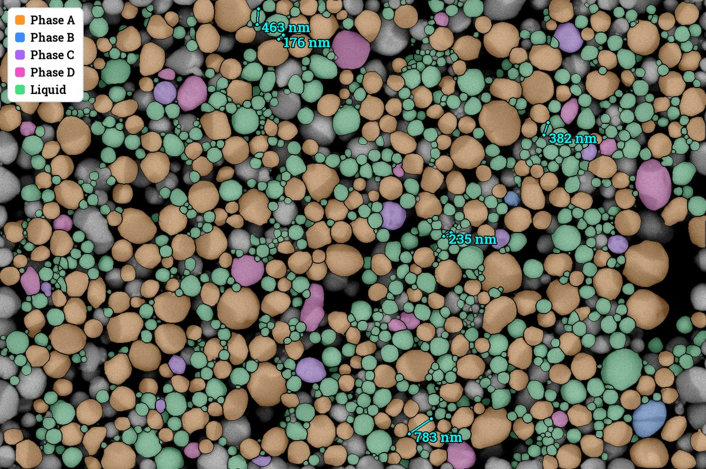
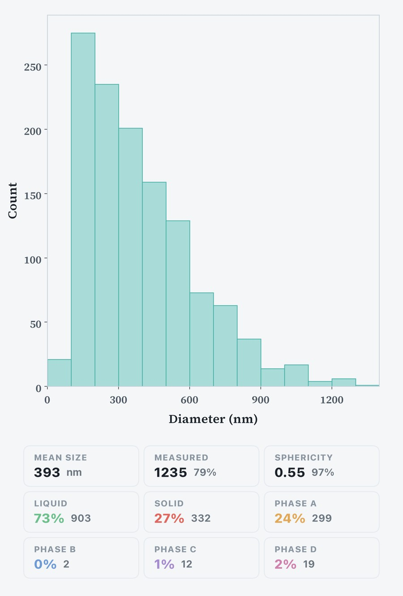

# SEM Particle Analyzer

Measures every particle in an SEM micrograph and classifies its phase state.



1558 particles found, each one measured and classified. The scale came from the
image's own info bar, with no calibration by hand.

**Aim:** replace the manual ImageJ routine (calibrating the scale bar, measuring
diameters one by one, judging the mean size by eye) and turn an afternoon of
work into a few seconds.

> ⚠️ Trained on one family of liquid-metal alloy particles, imaged on two
> specific microscopes. Other materials or instruments still get an answer, and
> that answer is wrong without a warning.

The **size measurement** travels further than the classification, because it is
geometry plus the scale bar rather than a learned prior. It still depends on the
segmentation finding particles that look like these.

For your own system, use **Training mode**. Label your own particles and
retrain the classifier on them.

## What it does

- **Finds every particle** in the image, the small ones included.
- **Measures each one.** Equivalent-circle diameter in nanometres, shape
  descriptors, and how much of it is cut off by the frame or hidden by a
  neighbour.
- **Reads the scale itself** from the microscope's info bar.
- **Classifies each particle** as solid or liquid, and each solid one by its
  internal phase arrangement (four classes, shown here as Phase A to D).
- **Refuses to measure what it can't see.** A particle mostly hidden behind
  another is counted but kept out of the size statistics, because its visible
  outline under-reports its true diameter.
- **Reports and exports** the size histogram, the composition breakdown, a
  per-particle CSV and the labelled overlay as a PNG.
- **Training mode** lets you correct particles by clicking them and retrain the
  classifier on your own labels, inside the app.



Everything runs locally. After the first launch it needs no internet at all.

The method will be described in a forthcoming publication.

## How accurate it is

Scored on hand-labelled photographs from two different microscopes, none of
which were ever part of the training data: **86 % overall accuracy** across all
classes.

## Download and run

**macOS (Apple Silicon), no Python, no terminal.** Take the zip from
[**Releases**](https://github.com/EfeUtku0/SEM-Particle-Analyzer/releases/latest),
unzip it and drag the app into Applications. On the **first launch, right-click
it → Open → Open**. A plain double-click gets refused because the app is
unsigned. Everything it needs is inside the bundle, the models included, so it
needs no internet to analyse. Once per launch it asks GitHub whether a newer
version exists and shows an Update button if so. It installs nothing.

**Windows (64-bit).** Take the zip from
[**v1.2.0-windows**](https://github.com/EfeUtku0/SEM-Particle-Analyzer/releases/tag/v1.2.0-windows),
right-click it → "Extract All…" and start `SEM Particle Analyzer.exe` in the
extracted folder. The first launch shows "Windows protected your PC". Click
**More info → Run anyway** (the app is unsigned). The models are inside the
folder, so it needs no internet either. This build runs on the processor, which
takes minutes per photo. With an NVIDIA card, run from source with CUDA instead
for seconds per photo (see [docs/windows.md](docs/windows.md)).

**Anywhere else, from source.** You need **Python 3.11–3.13** and about **6 GB
of free disk**:

```bash
git clone https://github.com/EfeUtku0/SEM-Particle-Analyzer.git
cd SEM-Particle-Analyzer
python3 -m venv .venv
.venv/bin/pip install -r requirements.txt      # Windows: .venv\Scripts\pip
.venv/bin/python app/gui.py                    # Windows: .venv\Scripts\python app\gui.py
```

Afterwards just double-click **`sem.command`** (macOS) or **`run.bat`**
(Windows). Run from source and **the first analysis downloads ~1.3 GB** of model
weights into your home folder, once. The packaged build has them already. Either
way the first analysis takes a minute or two while PyTorch warms up, and every
one after that takes seconds.

| | status |
|---|---|
| macOS, Apple Silicon (M1–M4) | tested, GPU (MPS) accelerated |
| macOS, Intel | not supported, PyTorch no longer ships wheels for it |
| Windows 11, x86-64 | tested, from the download above or from source. NVIDIA (CUDA) accelerated from source, otherwise CPU at 8 to 9 min per photo on a laptop i5 with the same results |
| Linux, x86-64 | should work from source. Without an NVIDIA card it falls back to the CPU, which is slow but correct |

There is no prebuilt Linux or Intel Mac download. PyInstaller does not
cross-compile, so each one has to be built on the platform it runs on (see
"Building a distributable app" below).

## The first launch

The app starts with a folder of **eight example micrographs** already in the
library, of the same particles it was trained for. Press **Analyze** on one of
them to see what the tool does before pointing it at your own data.

## Training mode

**Training** lets you click particles, give them the right class and retrain
the classifier on what you marked.

It is entirely local. Your labels go to a `SEM Eğitim` folder (Desktop on macOS,
Documents elsewhere) and the retrained model to your own data folder. Nobody
else's copy is affected.

**A retrained model replaces the one that ships with the app.** Retrain on a
handful of your own particles and the results get worse, for reasons that will
not be obvious. Retrain when you have labelled seriously. To go back to the
bundled model, delete `patternnet.pt` from the data folder below.

After every training run the app scores the new model against a held-out
reference set and shows how this run compares with the previous ones. So "did
that help?" gets a number, not a feeling.

## Where your data lives

Your folder tree, your analyses and any model you retrained live **outside** the
app, so updating or replacing it never touches them:

| OS | folder |
|---|---|
| macOS | `~/Library/Application Support/SEM Particle Analyzer` |
| Windows | `%APPDATA%\SEM Particle Analyzer` |
| Linux | `~/.local/share/SEM Particle Analyzer` |

**Your images are never moved, renamed or deleted.** The library only remembers
where they are. Its folders are virtual, so dragging an image between them
changes nothing on disk.

Deleting is always deliberate (right-click → Remove, or the Delete key; folders
ask first). Three automatic backups sit next to `library.json` anyway.
`library.json.bak` is the state before the last change, `library.startup.json`
the state when you opened the app, and `library.shrink.json` the state before
the image count last dropped. To restore one, quit the app, rename the backup to
`library.json` and start again.

## Building a distributable app

PyInstaller does not cross-compile, so build on the platform you are targeting:

```bash
.venv/bin/pyinstaller --noconfirm --clean sem_analyzer.spec
```

- macOS → `dist/SEM Particle Analyzer.app`. Zip it with
  `ditto -c -k --keepParent "dist/SEM Particle Analyzer.app" app-macos.zip`
- Windows → `dist/SEM Particle Analyzer/`. Zip the whole folder. The full
  Windows checklist (run, test, build, self-test) is in
  [docs/windows.md](docs/windows.md).

The build embeds the model weights from your home folder, so the packaged app
needs no downloads. If the spec prints `WARNING: ... weights not found`, run one
analysis from source first, then rebuild.

Check a build without opening a window:

```bash
SEMPA_SELFTEST=/path/to/image.jpeg "dist/SEM Particle Analyzer.app/Contents/MacOS/SEM Particle Analyzer"
```

## Known limits

- **One material system** (see the warning at the top).
- **Classification needs the kind of image it was trained on.** On any other
  image the app reports sizes only, by design.
- **Touching particles** are not always separated correctly. The app hides
  badly buried particles from the statistics rather than pretending to measure
  them.

## Built with

Python · PyTorch · OpenCV · scikit-image · PySide6 (Qt) · matplotlib ·
PyInstaller

## License

MIT, see [LICENSE](LICENSE).
